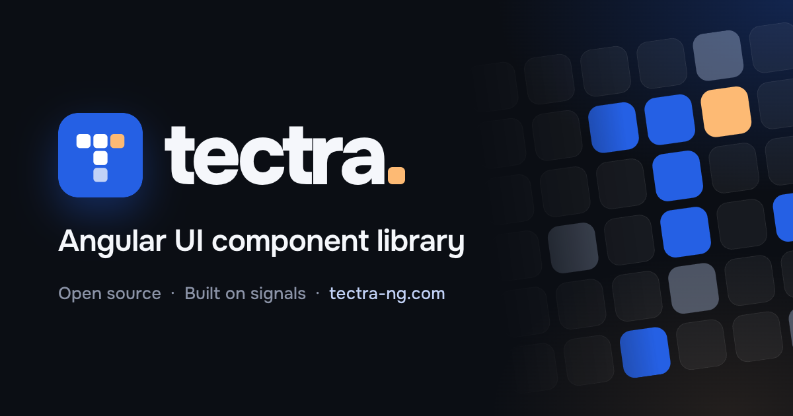

<p align="center">
  <a href="https://tectra-ng.com">
    
  </a>
</p>

<p align="center">
  <b>Open-source Angular UI kit for consoles and admin apps.</b><br />
  Design tokens, themes, 80+ components, charts, editors and ready page blocks — built on signals, rendered on the server.
</p>

<p align="center">
  <a href="https://www.npmjs.com/package/tectra-ng"></a>
  <a href="https://www.npmjs.com/package/tectra-ng"></a>
  <a href="https://github.com/kulakovskyi/tectra-ng/actions/workflows/ci.yml"></a>
  <a href="LICENSE"></a>
  <a href="https://angular.dev"></a>
  <br />
  <a href="https://www.bestpractices.dev/projects/16576"></a>
  <a href="https://www.bestpractices.dev/projects/16576/baseline-2"></a>
  <a href="https://scorecard.dev/viewer/?uri=github.com/kulakovskyi/tectra-ng"></a>
</p>

<p align="center">
  <a href="https://tectra-ng.com"><b>Documentation</b></a>
  &nbsp;·&nbsp;
  <a href="https://tectra-ng.com/getting-started">Getting started</a>
  &nbsp;·&nbsp;
  <a href="https://tectra-ng.com/theming">Theming</a>
  &nbsp;·&nbsp;
  <a href="ROADMAP.md">Roadmap</a>
  &nbsp;·&nbsp;
  <a href="CONTRIBUTING.md">Contributing</a>
</p>

---

## Why tectra

- **Everything in one kit** — 80+ components (forms, data, overlays, navigation, feedback, date and time), 22 page blocks, 23 SVG charts, a rich text editor, a code editor with diff, 334 icons, brand logos and country flags.
- **Modern Angular only** — standalone, signal inputs and models, OnPush, zoneless; works with reactive, template-driven and signal forms.
- **Server rendering out of the box** — every component prerenders and hydrates without a layout jump.
- **Your design, from tokens** — light and dark mode, 4 styles, 17 primary colours and 13 surfaces; change any component with `dt`, add classes with `pt`, or turn styles off with `unstyled`.
- **Accessible** — WAI-ARIA patterns, full keyboard support, axe checks of every docs page in light and dark.
- **Few dependencies** — charts, QR codes, icons and utilities are written in the kit; only the editors bring an engine core.
- **Tree-shakable** — one entry point per component, chart and utility, so an app ships only what it imports.

## Quick start

In an Angular CLI app one command does the whole setup:

```bash
ng add tectra-ng
```

It installs the kit and its Angular peers, adds `provideTectra` with the style, primary colour and surface you pick to `app.config.ts`, and the fonts to `index.html`. Pass `--style`, `--primary` and `--surface` to skip the questions; running it again changes nothing.

Or set it up by hand:

```bash
npm install tectra-ng
```

Provide a theme in `app.config.ts`:

```ts
import { provideTectra } from '@tectra-ng/core/config';
import { createTectraPreset } from '@tectra-ng/themes';

export const appConfig: ApplicationConfig = {
  providers: [provideTectra({ preset: createTectraPreset({ primary: 'blue' }) })],
};
```

Import a component where you use it:

```ts
import { TxSelect } from '@tectra-ng/ui/select';

@Component({
  imports: [TxSelect, ReactiveFormsModule],
  template: `<tx-select [options]="cities" [formControl]="city" placeholder="Pick a city" />`,
})
export class CityField {
  readonly cities = ['Kyiv', 'Lviv', 'Odesa', 'Kharkiv'];
  readonly city = new FormControl<string | null>(null);
}
```

Fonts, dark mode, locales and the theme builder: [tectra-ng.com/getting-started](https://tectra-ng.com/getting-started).

Try before installing: the bolt button on every example of [tectra-ng.com](https://tectra-ng.com) opens it in StackBlitz as a live, editable Angular CLI project with the theme you picked on the site.

## Packages

`tectra-ng` installs the whole kit at one version (the parts marked “Included”). Each part is also published on its own:

| Package | What it is | Included |
|---|---|:---:|
| [`@tectra-ng/ui`](packages/ui) | components, one entry point each: `@tectra-ng/ui/<component>` | ✓ |
| [`@tectra-ng/blocks`](packages/blocks) | ready page blocks: layouts, page header, filters panel, kanban, command palette … | ✓ |
| [`@tectra-ng/charts`](packages/charts) | SVG charts without a chart library: line, column, pie, gauge, sankey, gantt, heatmap … with SVG / PNG / CSV export | ✓ |
| [`@tectra-ng/utils`](packages/utils) | pipes, directives, validators, filter state, HTTP helpers, polling, clock | ✓ |
| [`@tectra-ng/qr`](packages/qr) | QR codes in plain TypeScript, no dependencies, works in any framework and in Node | ✓ |
| [`@tectra-ng/core`](packages/core) | behaviour without looks: config, overlay, a11y, forms, i18n, styles, ripple | ✓ |
| [`@tectra-ng/themes`](packages/themes) | semantic light / dark tokens, component tokens, presets | ✓ |
| [`@tectra-ng/tokens`](packages/tokens) | palettes, radius, typography, shadows, motion — plain data | ✓ |
| [`@tectra-ng/icons`](packages/icons) | 334 outline icons and `<tx-icon>` | ✓ |
| [`@tectra-ng/brand-icons`](packages/brand-icons) | brand logos from Simple Icons (CC0) | ✓ |
| [`@tectra-ng/flags`](packages/flags) | country flags, rectangle and circle, loaded one by one | ✓ |
| [`@tectra-ng/editor`](packages/editor) | rich text editor on the ProseMirror core and a renderer for saved text | — |
| [`@tectra-ng/code-editor`](packages/code-editor) | code editor on the CodeMirror core: search, inline and side by side diff, static highlighter | — |

The two editors are installed next to `tectra-ng` on their own, so apps without an editor do not carry its engine:

```bash
npm install @tectra-ng/editor @tectra-ng/code-editor
```

## Development

```bash
npm install
npx nx serve docs          # the docs site on http://localhost:4300
npx nx serve sandbox       # bare playground on http://localhost:4301
npm run build:packages     # npm packages into dist/packages/*
npm run lint               # ESLint + package boundaries
npm run test               # unit tests (Vitest)
npm run e2e                # Playwright checks of the docs site
```

Packages depend on each other in one direction; a package never imports anything to its right, and packages never import apps:

```
tokens → themes → core → ui → editor, code-editor, charts, utils → blocks ← qr
```

Every docs example is rendered live on its page, shown as source and checked by the Playwright suite — in light and dark, with axe.

| Folder | What lives there |
|---|---|
| `packages/*` | the npm packages above |
| `apps/docs` | the documentation site, deployed to [tectra-ng.com](https://tectra-ng.com) |
| `apps/sandbox` | local playground |
| `e2e/visual` | Playwright checks and axe |
| `tools` | docs registry, site files, icons, flags, brand images, release |

What comes next and in which order: [ROADMAP.md](ROADMAP.md).

## Contributing

Issues and pull requests are welcome — read [CONTRIBUTING.md](CONTRIBUTING.md) and the [code of conduct](CODE_OF_CONDUCT.md) first. Security issues go through the private process in [SECURITY.md](SECURITY.md), which also explains how to verify a release. How the project is run: [GOVERNANCE.md](GOVERNANCE.md); how it is built: [ARCHITECTURE.md](ARCHITECTURE.md); its threat model: [THREAT_MODEL.md](THREAT_MODEL.md).

## License

[MIT](LICENSE). Brand logos come from Simple Icons (CC0), flags from flag-icons (MIT), the export font is Onest (OFL).
